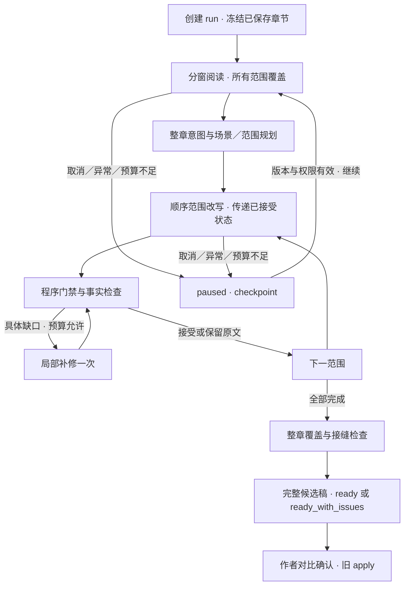

## Context

作者在已有章节上改写润色，章节通常 10000～20000 字，希望少量人工操作并保持人物、节奏、表达质量。新入口默认保留剧情，提供有限的场内创编权限。

2026-10-06 代码事实：

| 现有能力 | 证据与局限 |
|---|---|
| 分段设置 | `chapter-optimize.util.ts` 默认 3000、单段阈值 2800；`0` 禁用旧链路按字数分段 |
| 方案／正文分段 | `splitIntoSegments` 先用总长度决定段数，再按自然段数量分组；`resolveOptimizeDraftExecution` 当前支持正文分段。历史文档的「正文仍整章」已落后于代码 |
| 自动循环 | `runChapterAutoLoopWindows` 每窗独立循环、完成窗锁死；窗内按命中段落改写。下一窗复诊只收到上一窗末尾约 400 字，局部前后文来自窗内 |
| 按场成稿 | 旧档位 5200 字续窗，创编模式单窗且长度限制 5200；不可直接拿它处理两万字整章 |
| 生命周期 | `chapter-auto-loop-session.store.ts` 是 4 小时 TTL 的进程 Map，API 重启丢失；公共 SSE helper 将订阅断开视作取消 |
| 生成完成 | provider SSE 已解析 `finishReason`，但通用 API 流客户端没有将成功 end 和 finishReason 作为独立完整性条件 |
| Prompt 分类 | model tier、文风样本与上下文注入各有分类表；新增 key 必须同时进入相应表，不能只新增模板正文 |
| 最终 apply | `ProjectsService.applyChapterOptimization` 使用版本码 1307、正文安全规则及摘要策略，产生角色／索引等后续操作 |

相关进行中 change 可能有 tasks 勾选滞后。以代码和可执行测试确定可复用能力，不将「文件存在」或「tasks 已勾」当成发布证据。

## Goals / Non-Goals

**Goals**

- 一次输入要求、一次启动、一次最终审核；异常能指出具体冲突并保留成果。
- 用一个冻结的整章编辑意图统筹长章，避免窗之间重新规划。
- 保住完整场景的推进；解决过长自然段、跨窗盲区和输出截断。
- 生成候选稿时不触发章节保存、副作用或知识库状态更新。
- 有限调用、明确停止、有可恢复 checkpoint 和可追溯模板版本。

**Non-Goals**

- 文学质量由自动分数保证；跨场改剧情；自动应用；旧模式行为迁移。
- P0 多 API 副本分布式调度、跨章流水线、全新工作流编辑器。

## Decisions

### D1 — 新建窄编排，复用工具，不串接旧 HTTP 入口

在 projects 模块增加 `ChapterRefinementService`，协调纯 `chapter-refinement.engine.ts`、范围规划、生成 gateway 和 run repository。引擎通过依赖注入调用模型与 store，测试用可控依赖。

复用现有 SSE 生成客户端、provider adapter、角色卡和引用定位工具、对比 UI、apply 入口；不直接调用旧 controller，不把未保存候选稿临时写入 `Chapter.content`，不改变 `runChapterAutoLoopWindows` 的锁窗规则。

旧自动循环的选区定位、合法条目筛选等可抽为纯工具。新编排自行管理整章意图、执行范围与次数；不要为了复用整个引擎而复制旧固定逐段循环的局限。

### D2 — 权限由作者一次授予，路由只在权限内选择

创建 run 的 `rewritePolicy` 为 `preserve-plot`（默认）或 `scene-rewrite`。

- `preserve-plot`：可改变表达、对话组织、节奏和铺陈；必要事件、人物关系落点、伏笔、范围入场／散场事实保持。诊断可自动选择保留、局部修订或范围重写。
- `scene-rewrite`：允许同场的增删、并拍、顺序调整；仍锁定首尾事实及后文依赖。禁止跨场移动事件或新增影响后续的关系转折。

如果要求本身需要跨场重排或改变后文，新入口应返回明确的权限冲突，暂停并建议使用已有方案改写。不得悄悄放宽策略。内部方案可查看但默认无需确认；用户更改要求／策略必须新建 run。

### D3 — 两类分段：诊断窗口与写作范围

**诊断窗口**覆盖全文，按累计 UTF-16 长度规划，优先完整自然段。新入口将旧项目正值作为推荐值，规范化到 2000～5000；旧配置为 `0` 时，新入口使用自动目标 3000，并在 UI 显示「智能精修自动分窗」，不改变旧入口的整章语义。输入显式 `diagnosisTargetChars` 优先，合法区间 2000～5000。

超长自然段先找句末边界；单句仍过长时采用 UTF-16 安全边界作为只读诊断窗口，保留精确偏移，不将它直接认定为写作边界。所有窗口覆盖原文且无遗漏、无重复；窗口可带各约 1000 字邻文，只读邻文不得成为修改目标。

**写作范围**由已验证的场景边界、改动落点和输出预算决定，目标约 3500 字原文，默认长度顶 5200；实际预算不足时进一步缩小。3500／5200 是初始工程策略，不是模型稳定能力保证。

同一场跨越多个诊断窗时，合并为一个 `sceneId` 和一份场内意图。短场可以小于目标；不得为了凑长把两个独立场景合成一个可创编范围。长场先找动作完成、对话轮结束、目标变化等拍边界，再划执行单位；无法确认安全边界则保留原文并记录待处理问题，不盲目腰斩重写。

### D4 — 场景识别用原文索引，不接受模型自造偏移

冻结原文后建立 `SourceBlock[]`，每块有稳定 ID、起止 UTF-16 偏移、原文和分隔串。段落边界兼容空行、CRLF 和单换行文本，不重新格式化原文。

规则先提供明确分隔符／换时换地候选，诊断模型在同一次读取中建议场景边界与拍边界，引用 source block ID／首尾引文。程序校验覆盖、顺序、锚点唯一性；模型不能提交任意偏移或正文替换。

模型边界不合法时重试一次；仍不合法则退回连续保守范围，策略限制为保留剧情，标注低置信度。要求场内创编的范围不能在低置信度边界上自动执行。诊断窗不是场景、自然段不是情节拍，这三种 ID 不得混用。

### D5 — 先读完整章，再冻结一份简明意图

第一阶段按诊断窗顺序覆盖全文，输出必要事实、场景候选、衔接依赖和具体问题。之后只做一次整章汇总，形成 `ChapterBrief` 和每场 `SceneBrief`：

- 本章目标、不可改变的事件与人物落点；
- 每场要解决的具体问题、主要情绪变化、改动范围与验收落点；
- 首尾状态、后文需要的事实、逐字锁及合理篇幅方向。

事实必须带原文证据；未知事实标 unknown，不补造衣着、物件、伤势等。场景状态来自原文及只读前后文；用户风格偏好不能覆盖这些边界事实。

程序控制覆盖率：每个场景均有 `keep/patch/rewrite` 决策及理由，不能只诊断前半章。大量 source facts 通过 ID 引用，仅把当前范围相关内容提供给正文模型；不把整章账本反复塞进每次改写。

plan 合同偶发违约的恢复绑定 AQ-383，详见 [plan-contract-recovery.md](plan-contract-recovery.md)。先仅用唯一匹配的已验证证据回填缺字段，再最多一次额外 plan 调用；与其他重试共享名额，计数写 checkpoint。仍无效时只允许事实／范围独立有效的局部整场 keep；必要 Fact 或全章保护无效仍暂停，不放宽 schema 或丢弃事实。

整章规划输入使用压缩后的事实／问题索引和 ID 引用，不再次加入完整正文。若单次汇总仍超预算，先按连续场景确定性聚合已验证事实，再汇总编辑意图；不得截掉最后几窗的结果。仍无法容纳则暂停，不直接开始缺少整章目标的成稿。

### D6 — 精确范围替换与顺序执行

`baseText` 始终冻结。每个单位存原文 `[startOffset,endOffset)`、source hash、sceneId 和候选替换。程序按原始偏移排序拼回；长度变化不导致后续范围漂移。未命中的内容和分隔串逐码元保留。

每单位顺序执行，因为下一单位需要真实已接受的前段成稿。输入包括：

1. 当前范围原文与简明场内意图；
2. 最新已接受前文尾部约 1200 字；
3. 尚未改写后文开头约 1200 字（标只读）；
4. 有证据的入场／散场状态及全场进度；
5. 当前相关角色卡、项目文风及最多两个适用文风样本。

局部补修针对候选稿使用独立 `candidateRevision + candidate hash + quote/range`，不能复用冻结原文偏移。补修成功后替换该单位候选稿，再重算后续只读前文与状态。

### D7 — 状态记录承载事实，不让模型制造事实

2026-10-08 AQ-383 修正：inspect 结构解析不等于原文证据验证。索引与旧 checkpoint 须验证引文和作用域；合并场景的首片段入场、末片段散场与中途过程事实分开，过程事实不硬锁为首尾。确定性证据继承策略见 [事实合同修复](fact-contract-fix-2026-10-08.md)。

同日实跑后追加：plan 输入明确 protectedSpanIds 是整块字面不变，不用于一般事实保留或待润色目标。rewrite 输入传入冻结用户要求、章级语义事实及 deriveProtectedQuotes 得出的当前单位锁，与程序门禁完全同源；不自动删除锁或放宽校验。覆盖字数表示范围已被处理，包含退回原文，不证明实际表达改善。

`SceneState` 包含人物位置、朝向、可观察状态、持有物、必要事件进度、情绪落点和证据。初始状态来自冻结原文；范围检查模型同时提取候选稿末态，避免专门增加一次状态 LLM 调用。

状态事实必须引用已接受候选稿或冻结原文的真实片段。检查输出引用缺失、歧义或自行补造时不接受；原文未交代的属性保持 unknown。下一单位以已接受稿的实际状态为准；最终散场必须能接回冻结后文。

后续单位发现问题需要改前一单位时，只允许一次明确定位的接缝修复，更新对应候选稿并重新检查相关接缝。不能把「完成窗锁死」当成新编排的最终连续性保障，也不能重新生成全部已完成范围。

### D8 — 程序门禁、事实检查、文笔建议分别处理

| 检查 | 判定方式 | 行为 |
|---|---|---|
| 范围覆盖、越界、逐字锁、空输出、占位语、SSE 截断 | 程序可重复验证 | 拒绝该候选；保留上一份有效版本 |
| 情节遗漏、悬空指代、首尾状态冲突 | 模型对照证据，定位到候选范围 | 自动补修一次；仍有明确冲突则保留原文／暂停，并展示问题 |
| 文笔、张力、重复反应、感官细节是否自然 | 结合本轮目标的编辑建议 | 初次规划可采纳；生成后仅修具体明显退化，不追逐总分或增加新目标 |

正文先通过程序门禁再提交范围检查。检查只回报本次要求未落实、必要事实丢失或改坏；不得每轮提「还能更好」的新愿望。孤立主观评分不触发回滚。

每执行单位最多：初次改写一次 + 有具体证据的补修一次；同一次调用的暂时性网络／解析错误可重试一次，计入预算。默认保留当前有效稿；硬门禁失败不接受半成品。最终合并后复核全场目标覆盖和相邻范围接缝，发现已接受范围自身存在真实问题时可做一轮定位修复并重检，不开启第二轮整章创作。

在两稿都满足硬约束且主观优劣不明时，保留当前已接受稿，附建议供最终审核；不得宣称「自动选出了文学最优稿」。

「整章检查」是检查覆盖的范围，不要求一次塞入整章正文。程序先校验全部覆盖与锁，再按场、按相邻接缝对照相关原文／候选及目标；每个场和必要接缝都必须有检查记录。长场可以按同一范围索引分窗验证，最终汇总有证据的问题；检查预算不足时暂停，不能省掉后半章。

### D9 — 预算必须覆盖完整输入与输出，不能按原文字数猜能力

长度目标与 token 限额分别计算。模型调用 gateway 统计 system、任务、意图、原文、邻文、参考证据、文风样本全部输入；按计划输出字数和当前运行模型已经验证的输出限额分配 completion 预算，并沿用已有 thinking reserve 适配。

运行模型的已知限额须在评测配置中记录；不知道限额时采用保守调用策略并标 estimate，不能根据模型名自行猜上下文窗口。没有 tokenizer 时可以使用保守估算，但不能标 actual tokens。

超预算先缩减非必要检索材料／文风样本，再缩小执行范围；不得删掉用户要求、逐字锁、必要边界事实或原文目标。仍无法装入时暂停 `context_budget`。结束原因 `length`、缺成功 end 或连接提前结束均不得作为成功稿；缩小范围重试一次，仍失败则暂停。

默认每次执行尝试最多 80 次模型调用、30 分钟活动时间（暂停时间不计），包括重试；预留最终验证预算，不能把预算全部用于生成。预算未能覆盖全部目标时暂停 `budget_exhausted`，保留原文尾部，不能显示整章检查通过。继续由作者一次点击授权新的执行尝试预算，历史累计用量不清零。

P0 正文支持上限为 30000 UTF-16 单位；超限整体拒绝，不截断。这个工程上限不改变旧入口上限，扩大前须补充预算与长章评测。

数值均为初始可验证策略，需按实际模型的长章评测调整；不承诺两万字耗时。P0 不新增环境变量，策略放可测试 config 常量和 run 的 resolvedPolicy，用户只看到必要的范围／轮次进度。

### D10 — 运行与订阅解耦，可恢复但不引入新的队列平台

API POST 创建 run，冻结已保存章节与版本，持久化后返回。API 内 Nest provider 顺序执行后台 Promise；SSE GET 仅观察，断开不会取消 run。显式取消通过独立 cancel 请求中止当前上游调用；关闭弹窗继续运行，活动条继续可打开。

配置 PG 时使用独立 `ChapterRefinementRun` 表，避免每个 token 重写 workspace 或业务 JSON。最少字段：id、projectId、chapterNo、creatorId、status、phase、revision、snapshot/checkpoint JSON、createdAt/updatedAt/expiresAt；snapshot 不含密钥，checkpoint 含已接受范围和游标。只在单位接受、阶段切换和暂停点持久化；流式临时正文不成为可应用稿。

同一作者同一章节只能有一个 queued/running run。PG 用受控状态条件更新和唯一约束实现，内存实现用同一逻辑；执行 attemptId 隔离取消后迟到的模型回调。P0 后台执行明确只支持单 API 实例。服务重启将原先 queued/running 标为 paused/process_restart，保留最后 checkpoint，作者点击继续；不自动重新消耗模型费用。

未配置 PG 时提供 Map 实现，UI 明确「服务重启无法恢复」，浏览器刷新仍可恢复当前 API 内状态。已终结 run 默认保留 7 天，清理到期数据；候选稿与章节存储相互独立。

`expiresAt` 在 ready/ready_with_issues/failed 时设为终态时间后 7 天；paused 为最后 checkpoint 后 7 天无操作过期。queued/running 不执行 TTL 删除，继续后刷新保留期限。到期清理正文、快照与候选，仅留最多 7 天的最小墓碑用于 410。discard 立即清理正文材料并保留同类最小墓碑，不通过删除原章节实现丢弃。

每次继续／应用检查原章节版本及当前成员权限。版本变化沿用 1307，不对新正文自动重定位旧补丁；权限撤销暂停执行。并发取消、续跑、discard 与 checkpoint 保存须按 revision／attemptId 控制。

每次新模型调用前也检查当前成员权限及章节版本；变化时不再调用并保存暂停状态。模型路由和参数冻结，供应商凭据按当前安全配置解析而不写入快照；凭据或路由已不可用时暂停，不静默换模型继续。

### D11 — 冻结提示与参考，不受运行中 Settings 改动污染

run 创建时保存要求、策略、项目 systemPrompt、各新 task 的已发布文本／版本／hash、解析后的模型路由、角色／知识快照与文风样本。只保存模型配置标识，不保存密钥。

参考材料按现有预算从 run 开始时的项目状态构建，保存实际注入文本及来源；不对后续单位悄悄换用新角色卡。使用已有 `systemPromptOverride`、`projectSystemPromptOverride`、`frozenRetrievedEvidence`，必要时为**新模板 key**增加可选的冻结叙事／文风上下文支持。

诊断、规划、检查省略项目长写作指导与文风样本，接收结构化的本轮目标／必要事实。正文与补修接收项目文风。分类表必须分别覆盖新 key 的 utility/writing tier、检索短 query、摘要注入、下章衔接、文风样本；不得让正文原文全文进入 embedding query。

冻结原文和当前范围边界为最高业务事实来源；角色卡／知识库只作参考，冲突须显式记录，不自动用最新状态覆盖小说原文。项目可配置文风，仓库模板保持通用，不内置项目私有词表。

### D12 — 最终应用复用旧入口，run 完成不等于正文已保存

所有范围拼成完整候选稿后 UI 显示原文／新稿对比、主要改动、保留原文的范围、未解决问题和运行用量。ready 表示全部目标范围已处理且检查完成；ready_with_issues 表示完整检查已完成但仍有明确警告／部分范围保留原文。

paused／failed 的部分成果可查看，不开放 apply。作者确认后复用现有 `/optimize/apply`，传 `draftText`、冻结的 `expectedChapterUpdatedAt`、`planId=runId`、`preserveSummary=true`；用户可取消。现有正文安全规则与章节副作用仍执行，应用返回的真实正文须用于刷新 UI。

P0 不新增 run 专属 apply 接口，不承诺跨表 apply 原子事务；run 持有候选稿而不是章节应用记录，因此不设置 `applied` 状态。重复应用仍受旧章节版本锁限制。P0 最终对比区只读，人工编辑可在章节编辑器完成，避免未检查修改混入自动候选。

## Architecture / State Flow

图中继续的落点由 checkpoint 决定，不重复已完成阅读／已接受改写。补修计数进入 checkpoint，恢复不能把计数清零造成无限循环。

## Risks / Trade-offs

- 场景识别可能错：范围锚点验证、低置信度降级、原文保留；不能把模型识别当准确事实。
- 少人工不等于无风险：仅明确硬失败自动拒绝；有证据的剧情冲突可暂停，其余警告汇总到一次最终审核。
- 新 run 持久化增加迁移范围：独立表和 repository，先跑恢复／取消用例，再接完整长章链路；避免塞入旧 workspace JSON。
- 长章后台任务资源占用：单作者单章一个活动 run，调用／时间预算与显式取消，暂停而非静默截断。
- 写作指导冲突：任务 Prompt 阶段化，运行输入提供事实优先级；所有新模板默认草稿，评测前不默认开放入口。
- 使用旧 apply 的内容安全处理可能再次调整正文：UI 使用返回的正文，不显示未经核对的「逐字应用」承诺。

## Migration Plan

文档确认 → Contract First 更新 OpenAPI、类型、错误码说明 → run 表迁移 → 窄竖切实现 → 旧入口回归 → 真实模型长章评测 → 新模板发布与入口开放。

若开发开始时仓库架构规范仍要求记录全局调整，先在既有架构／治理文档加入指向本 change 的决策链接。任务编号按仓库当前队列分配，状态只在开始对应实现时登记；本设计不预占 AQ 编号、不修改旧 change 的任务状态。

回滚：隐藏智能精修入口，停止新 run 创建，取消／暂停活动 run；保留 checkpoint 可导出候选。旧入口、已保存章节不依赖新 run 表，先停用功能再决定迁移回滚，禁止通过删除 run 表回滚章节。

## Open Questions

无必须阻塞编码的产品问题。窗口／输出策略和评测性能门槛属于发布前实验参数，依 evaluation.md 记录实际结果，不把当前建议冒充已验证的最优值。
